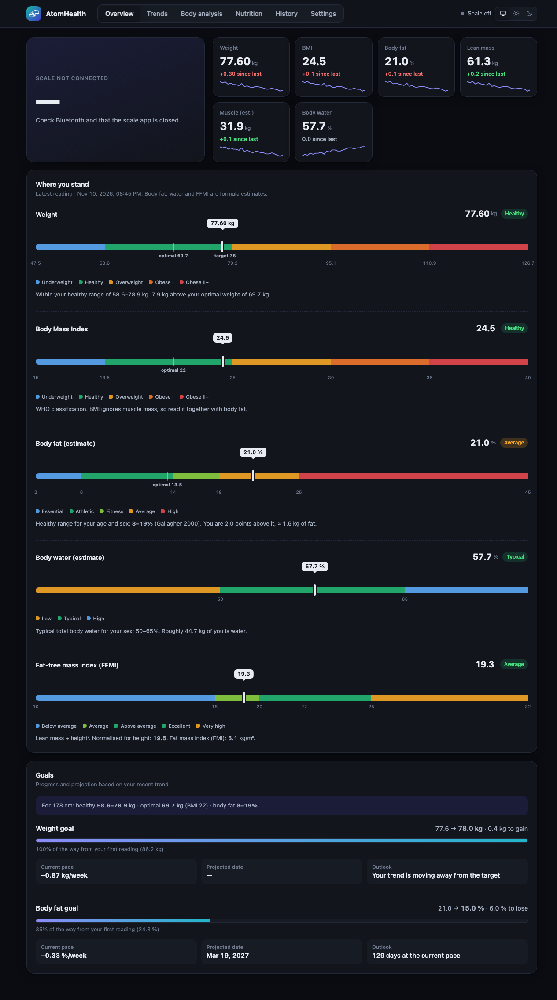
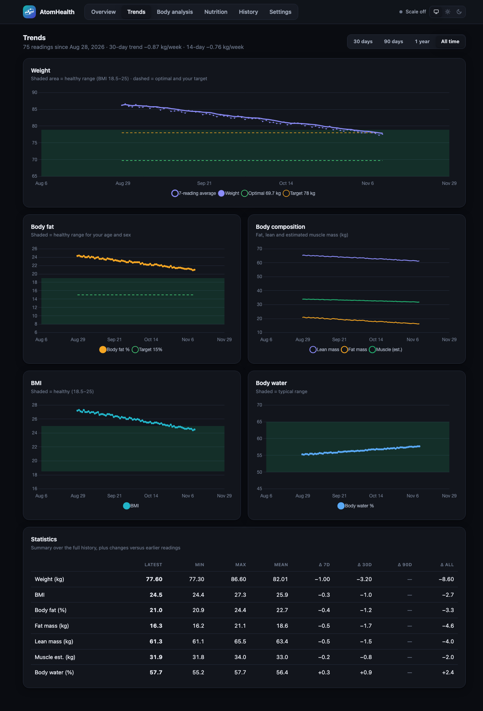
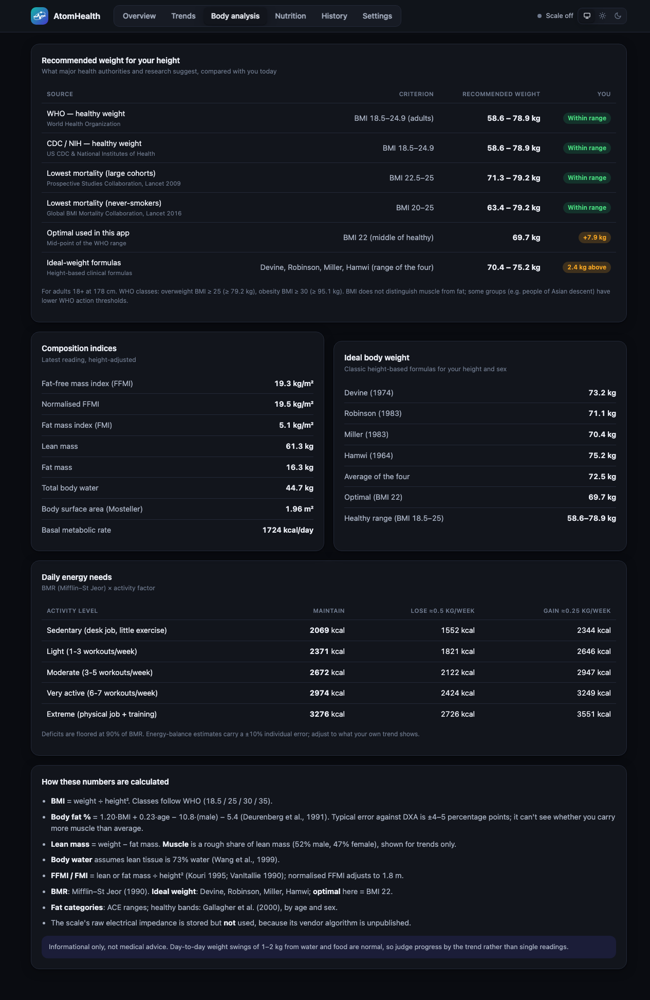
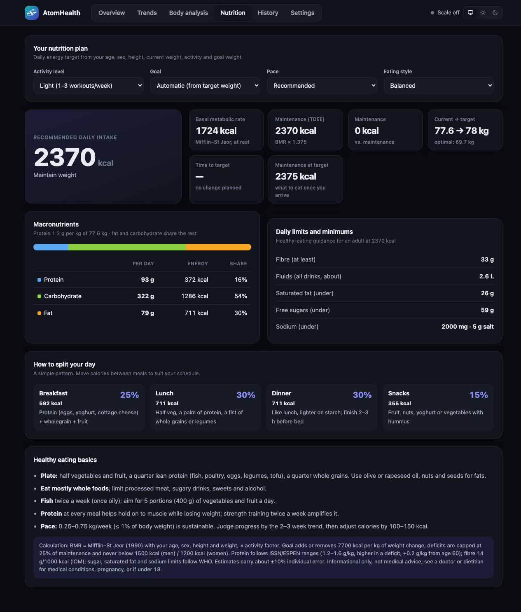
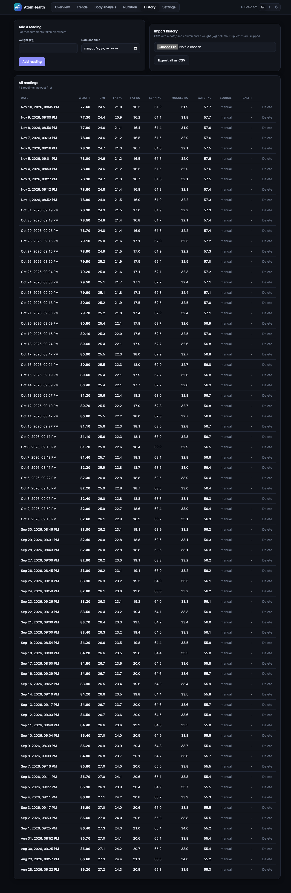

# AtomHealth

Local web app for the Raganet HG007-1 Bluetooth scale. The scale broadcasts its weight in
its BLE advertisement (no pairing); `atomhealth` listens, stores readings in SQLite (`data/weight.db`),
and serves a dashboard with estimated body composition, goals and statistics.

## Features

- **Overview** – live scale status, headline cards (weight, BMI, body fat, lean mass, muscle, water) with sparklines, range bars showing where you stand, and goal progress with a projected date.
- **Trends** – weight and body-composition charts over time.
- **Body analysis** – detailed breakdown of fat, lean mass, water, BMR and related indices.
- **Nutrition** – calorie and diet-pace guidance based on your goal and activity level.
- **History** – every reading, with manual entry, delete, CSV import and export.
- **Settings** – height, age/birth date, sex, targets, and the Apple Health Shortcut recipe.
- Light/dark/system themes, installable as a PWA, data stays on your machine.

| Trends | Body analysis |
|---|---|
|  |  |
| **Nutrition** | **History** |
|  |  |

*Screenshots use synthetic demo data.*

## Usage

Local web app for the Raganet HG007-1 Bluetooth scale. The scale broadcasts its weight in
its BLE advertisement (no pairing); `atomhealth` listens, stores readings in SQLite (`data/weight.db`),
and serves a dashboard with estimated body composition, goals and statistics.

    .venv/bin/python -m atomhealth            # http://localhost:8765  (run from your own Terminal for Bluetooth access)
    .venv/bin/python -m atomhealth --lan      # also reachable by your phone (Health feed only)
    .venv/bin/python -m atomhealth --no-ble   # manual entry / testing

Close the scale's phone app (it can hog the scale) and step on the scale: readings are saved once the number holds steady for 3 s.

Set height / age / sex / targets in Settings. With no targets set, the optimal weight (BMI 22) and an age/sex body-fat range are used.
Fat %, lean/muscle mass, water and BMR are formula estimates (Deurenberg, Mifflin-St Jeor), not measurements.

Apple Health: Settings tab shows the iOS Shortcut recipe (feed: `/api/health/pending?token=...`).

## Layout

    src/atomhealth/   app.py (server), bodycomp.py (formulas), static/ (dashboard UI)
    scripts/          scale.py BLE debugging tool (scan, watch, listen), probe.py
    data/             weight.db, weights.csv (git-ignored); data/debug/ captured BLE logs
    tests/            pytest smoke tests
    .env              local settings (see .env.example)

Setup: `python -m venv .venv && .venv/bin/pip install -e '.[dev]'`; tests: `.venv/bin/python -m pytest`.
Override the data location with `ATOMHEALTH_DATA_DIR`.

## License

[MIT](LICENSE)
